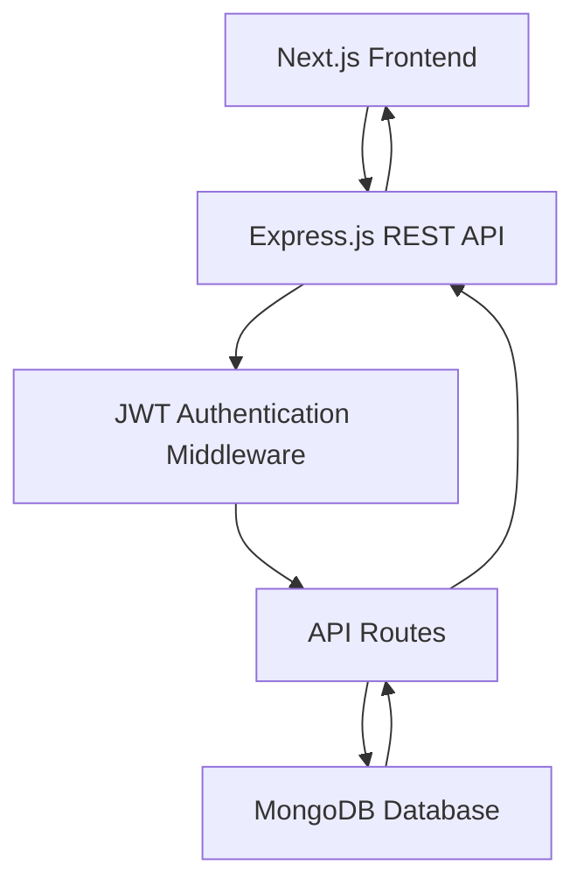

# Doctor Tracker – Backend API

## 1. Description

Doctor Tracker Backend is a RESTful API built with Node.js, Express.js, and MongoDB. It handles doctor and patient management, database operations, doctor-patient relationships, and dashboard data. The backend integrates JWT authentication to protect API endpoints and ensure secure communication with the Next.js frontend.

## 2. Technology Stack

| Technology | Purpose |
|---|---|
| Node.js | JavaScript runtime |
| Express.js | Backend framework |
| MongoDB | NoSQL database |
| JWT | Authentication and authorization |
| JOSE | JWT verification |
| CORS | Cross-origin communication |
| dotenv | Environment variable management |

## 3. Setup Guide

### Prerequisites

Install the following before starting:

- Node.js (LTS recommended)
- npm
- MongoDB or MongoDB Atlas
- Git

### Step 1: Clone the Repository

```bash
git clone https://github.com/towhidul-dev-ai/doctor-tracker-server.git
cd doctor-tracker-server
```

### Step 2: Install Dependencies

```bash
npm install
```

### Step 3: Configure Environment Variables

Create a `.env` file in the backend root directory.

Example:

```env
PORT=8000
MONGODB_URL=your_mongodb_connection_string
FRONTEND_URL=http://localhost:3000
```

**Environment Variables:**

| Variable | Description |
|---|---|
| PORT | Backend server port |
| MONGODB_URL | MongoDB connection string |
| FRONTEND_URL | Frontend URL used for JWT verification and related configuration |

**Important:**

- Replace example values with your actual configuration.
- The database name is `doctor_tracker`.
- Never upload your `.env` file or database credentials to GitHub.
- Configure production environment variables in your deployment platform.

### Step 4: Run the Backend

Start the development server:

```bash
npm run dev
```

The backend should run at:

```text
http://localhost:8000
```

If your project uses a different development script, use the script defined in `package.json`.

## 4. System Architecture

The backend follows a REST API architecture. It receives requests from the Next.js frontend, verifies authentication when required, communicates with MongoDB, and returns JSON responses.

### Architecture Overview



### Request Flow

1. The frontend sends an HTTP request to the Express API.
2. Protected requests include a JWT in the Authorization header.
3. Authentication middleware verifies the token.
4. The API processes the requested operation.
5. MongoDB performs the required database operation.
6. The backend returns a JSON response to the frontend.

## 5. API Documentation

The backend provides REST API endpoints for managing doctors, patients, and dashboard information.

**Base URL:**

```text
http://localhost:8000
```

### Doctor Management

| Method | Endpoint | Description |
|---|---|---|
| GET | `/api/doctors` | Retrieve doctors |
| GET | `/api/doctors/:id` | Retrieve a specific doctor |
| POST | `/api/doctors` | Add a new doctor |
| GET | `/api/doctors/:id/patients` | Retrieve patients of a doctor |
| POST | `/api/doctors/:id/patients` | Add a patient to a doctor |
| DELETE | `/api/doctors/:id/patients/:patientId` | Remove a patient from a doctor |

### Patient Management

| Method | Endpoint | Description |
|---|---|---|
| GET | `/api/patients` | Retrieve patient records |
| PATCH | `/api/patients/:id` | Update patient information |
| DELETE | `/api/patients/:id` | Delete a patient record |

### Dashboard Analytics

If implemented, the following endpoints provide dashboard statistics:

| Method | Endpoint | Description |
|---|---|---|
| GET | `/api/dashboard/stats` | Retrieve dashboard statistics |
| GET | `/api/dashboard/patients-per-doctor` | Retrieve patient counts by doctor |
| GET | `/api/dashboard/monthly-patients` | Retrieve monthly patient statistics |

**Note:** Update these endpoint lists to match your actual Express routes. Do not list endpoints that are not implemented.

## 6. Database Structure

The application uses MongoDB with the database name `doctor_tracker`.

### Doctors Collection

Stores doctor information, including:

- Doctor name
- Email address
- Phone number
- Specialty
- Qualification
- Experience
- Consultation fee
- Hospital or address
- Image URL

### Patients Collection

Stores patient information, including:

- Patient name
- Email address
- Phone number
- Age or other patient details, if collected
- Associated doctor ID
- Registration information

The doctor-patient relationship is maintained using doctor and patient identifiers.

## 7. Authentication and Security

The backend integrates with Better Auth through JWT-based authentication.

### Authentication Process

1. Users authenticate through the frontend.
2. Better Auth provides an authentication token.
3. The frontend sends the token with protected API requests.
4. Express middleware verifies the JWT using the configured JSON Web Key Set (JWKS).
5. Requests with invalid or missing tokens are rejected.

### Authorization Header

Protected requests should include:

```http
Authorization: Bearer YOUR_JWT_TOKEN
```

### Security Features

- JWT verification for protected routes.
- Environment variables for sensitive configuration.
- CORS configuration for frontend communication.
- Input validation for database operations.
- Error handling for API requests.

## 8. Technical Decisions

### Decision 1: Express.js REST API

**Why Express.js?**

Express.js provides a lightweight and flexible framework for building REST APIs.

**Benefits:**

- Simple route management.
- Separation of API logic and frontend components.
- Easy integration with MongoDB.
- Reusable middleware.
- Independent backend deployment.

### Decision 2: MongoDB Database

**Why MongoDB?**

MongoDB provides a flexible document-based structure suitable for storing doctor and patient records.

**Benefits:**

- Flexible document schema.
- Efficient CRUD operations.
- Support for aggregation pipelines.
- Easy relationship management through document identifiers.
- Suitable for dashboard data aggregation.

## 9. Error Handling

The backend uses HTTP status codes to communicate API results.

| Status Code | Meaning |
|---|---|
| 200 | Request successful |
| 201 | Resource created |
| 400 | Invalid request |
| 401 | Unauthorized |
| 404 | Resource not found |
| 500 | Internal server error |

## 10. Project Links

- **Live Frontend:** https://doctor-frontend-tau.vercel.app
- **Frontend Repository:** https://github.com/towhidul-dev-ai/doctor-tracker
- **Backend Repository:** https://github.com/towhidul-dev-ai/doctor-tracker-server

## 11. Future Improvements

- Advanced API validation.
- More optimized MongoDB queries and indexes.
- Role-based authorization.
- Advanced dashboard analytics.
- API documentation using Swagger.
- Automated backend testing.

## 12. License

This project was developed for educational and demonstration purposes.
